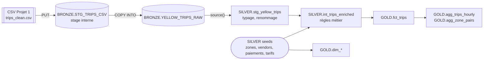

# Projet 2 — Data Warehouse NYC Yellow Taxi (Snowflake + dbt)

Transformer le **CSV nettoyé du Projet 1** (NYC TLC Yellow Taxi, janvier 2023) en
une plateforme analytique **structurée, testée, documentée et reproductible** :
ingestion native Snowflake (`PUT` + `COPY INTO`) dans une couche **Bronze**, puis
modélisation dbt en couches **Silver** et **Gold** (schéma en étoile).

> Tout se relance avec une commande (`python scripts/run_all.py`) une fois `.env`
> rempli et le CSV placé dans `data/`. Aucun secret n'est versionné.

## Sommaire

1. [Contexte et objectif](#1-contexte-et-objectif)
2. [Architecture](#2-architecture)
3. [Structure du dépôt](#3-structure-du-dépôt)
4. [Prérequis](#4-prérequis)
5. [Installation et configuration](#5-installation-et-configuration)
6. [Exécution](#6-exécution)
7. [Ingestion Snowflake : comment le chargement est prouvé](#7-ingestion-snowflake--comment-le-chargement-est-prouvé)
8. [Architecture Medallion : rôle de chaque couche](#8-architecture-medallion--rôle-de-chaque-couche)
9. [Modélisation Gold : grain, faits, dimensions](#9-modélisation-gold--grain-faits-dimensions)
10. [Le projet dbt](#10-le-projet-dbt)
11. [Tests : quelles règles, quelle sévérité, pourquoi](#11-tests--quelles-règles-quelle-sévérité-pourquoi)
12. [Jinja et macros](#12-jinja-et-macros)
13. [Seeds et snapshots](#13-seeds-et-snapshots)
14. [Analyses](#14-analyses)
15. [Documentation et lineage : d'une métrique Gold jusqu'au CSV](#15-documentation-et-lineage--dune-métrique-gold-jusquau-csv)
16. [Maîtrise des coûts Snowflake](#16-maîtrise-des-coûts-snowflake)
17. [Secrets et reproductibilité](#17-secrets-et-reproductibilité)
18. [Limites du projet](#18-limites-du-projet)

---

## 1. Contexte et objectif

Le Projet 1 a produit un CSV exploitable : 30 colonnes, les lignes physiquement
impossibles retirées (5 règles), les anomalies réelles **conservées et marquées**
par 7 indicateurs `flag_*`. Mais un CSV n'est pas un entrepôt : pas de typage
garanti, pas de référentiels, pas de modèle orienté questions, pas de tests
rejouables.

Ce projet répond aux questions des analystes — **activité, temps et trajet,
revenus, paiement, localisation, qualité** — avec :

- une ingestion Snowflake **prouvée complète** (même nombre de lignes du CSV à la Bronze) ;
- un modèle **en étoile** au grain d'un trajet, avec 6 dimensions et 2 agrégats ;
- **80+ tests dbt**, chacun rattaché à une règle de qualité identifiable ;
- une documentation dbt et un **lineage** qui relient chaque métrique au CSV.

Seule source de données : le CSV du Projet 1 (aucune nouvelle extraction). Les
seules données ajoutées sont quatre **petits référentiels** officiels TLC (seeds,
§13).

## 2. Architecture



| Couche | Schema | Construite par | Objets |
|---|---|---|---|
| Bronze | `BRONZE` | scripts SQL (`sql/snowflake/`) | file format, stage, `YELLOW_TRIPS_RAW` |
| Silver | `SILVER` | dbt | `stg_yellow_trips` (view), `int_trips_enriched` (table), 4 seeds |
| Gold | `GOLD` | dbt | `fct_trips`, `dim_date`, `dim_time_of_day`, `dim_location`, `dim_payment_type`, `dim_vendor`, `dim_rate_code`, `agg_trips_hourly`, `agg_zone_pairs` |

Schémas détaillés (flux complet, diagramme entité-relation, grain de chaque
table) : [`docs/architecture.md`](docs/architecture.md). Analyse du dataset :
[`docs/dataset_analysis.md`](docs/dataset_analysis.md).

## 3. Structure du dépôt

```
.
├── README.md
├── .gitignore               secrets, CSV, target/ exclus
├── .env.example             modèle de configuration (sans valeur)
├── profiles.example.yml     modèle de profil dbt (uniquement des env_var)
├── requirements.txt
├── Dockerfile               image d'exécution (Python 3.12 + dbt-snowflake)
├── docker-compose.yml       lancement : docker compose run --rm dw
├── .dockerignore            secrets et CSV exclus de l'image
├── dbt_project.yml          configuration du projet dbt (couches, vars, hooks)
├── sql/snowflake/           environnement et ingestion (exécutés hors dbt)
│   ├── 01_warehouse.sql              warehouse XS, auto-suspend 60 s
│   ├── 02_database_schemas.sql       database + BRONZE / SILVER / GOLD
│   ├── 03_file_format_stage.sql      file format CSV + stage interne
│   ├── 04_bronze_table.sql           table Bronze typée
│   ├── 05_load_bronze.sql            PUT + TRUNCATE + COPY INTO
│   ├── 06_check_load.sql             contrôles du chargement
│   ├── 07_suspend_warehouse.sql      suspension manuelle
│   ├── 08_resource_monitor_optional.sql  plafond de crédits (ACCOUNTADMIN)
│   └── 99_teardown_optional.sql      suppression de l'environnement
├── scripts/                 exécution reproductible (Python)
│   ├── run_all.py            tout, dans l'ordre
│   ├── setup_snowflake.py    exécute 01 -> 04
│   ├── load_bronze.py        contrôle le CSV, exécute 05 + 06, écrit la preuve
│   ├── collect_evidence.py   preuves dbt, analyses, volumes, lineage, docs
│   ├── generate_keypair.py   paire de clés RSA (authentification sans MFA)
│   └── load_env.ps1 / .sh    charge .env dans le terminal (pour dbt)
├── models/
│   ├── staging/              source Bronze déclarée + stg_yellow_trips
│   ├── intermediate/         int_trips_enriched (règles métier)
│   ├── marts/core/           fct_trips + 6 dimensions
│   ├── marts/aggregates/     agg_trips_hourly, agg_zone_pairs
│   ├── docs.md               blocs de documentation (grain, règles, métriques)
│   └── exposures.yml         usage aval (tableau de bord)
├── tests/                    tests singuliers + tests/generic/ (tests génériques)
├── macros/                   generate_schema_name, to_money, bucketize, suspend_warehouse
├── seeds/                    4 référentiels TLC (CSV < 10 Ko)
├── snapshots/                README : pourquoi aucun snapshot
├── analyses/                 4 requêtes analytiques non matérialisées
├── data/                     emplacement local du CSV (non versionné)
└── docs/                     architecture, analyse du dataset, preuves, docs dbt
```

## 4. Prérequis

| Outil | Version | Rôle |
|---|---|---|
| Projet 1 terminé | — | `trips_clean.csv` (+ `transform_summary.json`) |
| Compte Snowflake | rôle `SYSADMIN` (ou équivalent) | créer warehouse, database, schemas, stage, tables |
| Docker Desktop **ou** Python 3.10 – 3.12 | — | exécution des scripts et de dbt (Docker recommandé, §5.0) |
| dbt Core + dbt-snowflake | ≥ 1.10, < 2.0 | modélisation, tests, documentation |
| Git | — | versionnement |

Notions mobilisées : database, schema, table, stage, warehouse, `COPY INTO`, clé
primaire/étrangère, grain, fait, dimension, agrégation, Medallion.

## 5. Installation et configuration

Les commandes sont données pour **PowerShell (Windows)** ; l'équivalent bash est
indiqué quand il diffère.

### 5.0 Option recommandée : tout exécuter dans Docker

Aucune installation Python ni dbt sur la machine : seul **Docker Desktop** est
nécessaire. L'image contient Python 3.12, dbt Core, dbt-snowflake et le
connecteur Snowflake. Le dépôt est **monté en volume** : les preuves
(`docs/evidence/`), la documentation dbt et `target/` apparaissent directement
dans le dossier du projet. Les identifiants viennent de `.env` au lancement et
ne sont **jamais copiés dans l'image** (`.dockerignore` exclut `.env`, les clés et
le CSV).

```powershell
Copy-Item .env.example .env          # puis remplir (§5.2)
Copy-Item <chemin-projet-1>\data\processed\2023-01\trips_clean.csv data\
Copy-Item <chemin-projet-1>\reports\2023-01\transform_summary.json data\   # facultatif

docker compose build                 # une fois (ou après un changement de requirements.txt)
docker compose run --rm dw           # pipeline complet : python scripts/run_all.py
```

Commandes ponctuelles dans le même conteneur :

```powershell
docker compose run --rm dw python scripts/setup_snowflake.py
docker compose run --rm dw python scripts/load_bronze.py
docker compose run --rm dw dbt debug
docker compose run --rm dw dbt build
docker compose run --rm dw python scripts/collect_evidence.py
docker compose run --rm dw python scripts/run_all.py --skip-setup --skip-load
docker compose run --rm --service-ports dw dbt docs serve --host 0.0.0.0 --port 8080
#   puis ouvrir http://localhost:8080 (Ctrl+C pour arrêter)
```

Particularités du mode Docker :

- le CSV doit être dans `data/` : `docker-compose.yml` force `P1_CSV_PATH=data/trips_clean.csv`,
  car un chemin Windows (`C:/...`) n'existe pas dans le conteneur Linux ;
- `profiles.yml` est créé automatiquement depuis `profiles.example.yml` au premier
  lancement ; `load_env.ps1` est inutile (Docker lit `.env` lui-même) ;
- paire de clés : placer la clé dans `.snowflake/` **à la racine du dépôt** (ignoré
  par Git et par Docker) et écrire `SNOWFLAKE_PRIVATE_KEY_PATH=/app/.snowflake/rsa_key_nyc_taxi.p8` ;
- mot de passe contenant `$` : l'entourer de **guillemets simples** dans `.env`
  (`SNOWFLAKE_PASSWORD='...'`), sinon Docker Compose tente de l'interpréter comme une variable.

Les sections 5.1 et 5.3 ne concernent que l'exécution sans Docker.

### 5.1 Environnement Python

```powershell
git clone <url-du-depot> nyc-taxi-dw
cd nyc-taxi-dw
python -m venv .venv
.\.venv\Scripts\Activate.ps1          # bash : source .venv/bin/activate
pip install -r requirements.txt
dbt --version                          # doit afficher Core 1.x et le plugin snowflake
```

### 5.2 Identifiants Snowflake (`.env`, jamais versionné)

```powershell
Copy-Item .env.example .env            # COPIER (pas renommer) : .env.example doit rester
notepad .env
```

Renseigner `SNOWFLAKE_ACCOUNT` (format `organisation-compte`, visible dans
Snowsight → menu du compte → *Account details*), `SNOWFLAKE_USER`, puis **une**
méthode d'authentification :

- **Paire de clés (recommandée)** — Snowflake impose de plus en plus la MFA aux
  connexions par mot de passe, ce qui bloque les scripts. La clé est générée hors
  du dépôt :
  ```powershell
  python scripts/generate_keypair.py
  ```
  Le script affiche l'instruction `ALTER USER ... SET RSA_PUBLIC_KEY=...` à
  exécuter une fois dans Snowsight, et la ligne `SNOWFLAKE_PRIVATE_KEY_PATH` à
  copier dans `.env` (avec `DBT_TARGET=keypair`).
- **Mot de passe** : `DBT_TARGET=password` et `SNOWFLAKE_PASSWORD=...`.

### 5.3 Profil dbt

```powershell
Copy-Item profiles.example.yml profiles.yml   # ignoré par Git
. .\scripts\load_env.ps1                       # charge .env dans le terminal (le point initial est indispensable)
                                               # bash : source scripts/load_env.sh
dbt debug                                      # "All checks passed!"
```

`profiles.yml` ne contient que des `env_var()` : les valeurs viennent de `.env`.
Les scripts Python lisent `.env` eux-mêmes ; seul l'usage direct de la commande
`dbt` demande `load_env.ps1`.

### 5.4 Placer le CSV du Projet 1

```powershell
Copy-Item ..\nyc-taxi-pipeline\data\processed\2023-01\trips_clean.csv data\
Copy-Item ..\nyc-taxi-pipeline\reports\2023-01\transform_summary.json data\
```

(ou indiquer un autre chemin dans `P1_CSV_PATH`).

### 5.5 Aligner les seuils avec le Projet 1

Les tests revérifient les règles de suppression du Projet 1. Si `config.yaml` du
Projet 1 utilise d'autres valeurs que celles-ci, les reporter dans
`dbt_project.yml` → `vars` :

| var dbt | Projet 1 (`config.yaml` → `cleaning`) | Valeur par défaut |
|---|---|---|
| `p1_max_duration_min` | `max_duration_minutes` | 180 |
| `p1_max_speed_mph` | seuil de vitesse | 80 |
| `amount_tolerance` | `amount_tolerance` | 0.01 |

## 6. Exécution

### En une commande

```powershell
docker compose run --rm dw          # avec Docker (§5.0)
python scripts/run_all.py           # sans Docker
```

Enchaîne : création de l'environnement → chargement Bronze + preuves → `dbt debug`
→ `dbt build` → preuves dbt, analyses, lineage, documentation statique.

### Étape par étape

```powershell
# 1. Environnement Snowflake (warehouse, database, 3 schemas, file format, stage, table Bronze)
python scripts/setup_snowflake.py
#    option : + resource monitor (rôle ACCOUNTADMIN requis)
python scripts/setup_snowflake.py --resource-monitor

# 2. Ingestion : PUT -> stage -> COPY INTO -> Bronze, puis contrôles
python scripts/load_bronze.py             # écrit docs/evidence/01_ingestion.md

# 3. dbt : seeds, modèles et tests dans l'ordre du graphe
. .\scripts\load_env.ps1
dbt build                                 # = dbt seed + run + test, nœud par nœud

# 4. Preuves et documentation
python scripts/collect_evidence.py        # docs/evidence/02..05 + docs/dbt-docs/index.html
dbt docs serve                            # navigateur : modèles, colonnes, lineage
```

Sans Python, les mêmes scripts SQL s'exécutent avec Snowflake CLI (les variables
`<% nom %>` sont sa syntaxe de gabarit) :

```powershell
snow sql -f sql/snowflake/01_warehouse.sql -D warehouse=NYC_TAXI_WH
snow sql -f sql/snowflake/05_load_bronze.sql -D database=NYC_TAXI_DB -D warehouse=NYC_TAXI_WH -D csv_path=C:/chemin/trips_clean.csv
```

### Commandes dbt utiles

| Commande | Effet |
|---|---|
| `dbt build` | seeds + modèles + tests dans l'ordre du DAG ; un test bloquant en échec arrête les modèles en aval |
| `dbt build --select +fct_trips` | `fct_trips` et tout ce dont il dépend |
| `dbt test --select stg_yellow_trips` | tests d'un seul modèle |
| `dbt source freshness` | fraîcheur de la Bronze (`_loaded_at`) |
| `dbt compile --select path:analyses` | compile les analyses dans `target/compiled/` |
| `dbt docs generate && dbt docs serve` | documentation et lineage |

## 7. Ingestion Snowflake : comment le chargement est prouvé

**Flux** : CSV local → `PUT` (compression gzip côté client) → stage interne
`BRONZE.STG_TRIPS_CSV` → `COPY INTO BRONZE.YELLOW_TRIPS_RAW`.

**Choix et pourquoi :**

- **Stage interne** plutôt qu'un bucket S3/Azure : aucun identifiant cloud
  supplémentaire à gérer (donc à ne pas laisser fuiter), et un seul fichier.
- **Table Bronze typée** (types du Projet 1 : `Int64` → `NUMBER`, `float64` →
  `FLOAT`, `bool` → `BOOLEAN`, `datetime` → `TIMESTAMP_NTZ`) : le typage est un
  **contrat**. Une valeur qui ne respecte pas le type annoncé fait échouer le
  chargement au lieu de passer en texte et de casser plus loin.
- **`ON_ERROR = ABORT_STATEMENT`** : à la première ligne invalide, rien n'est
  chargé. Une Bronze partielle fausserait tous les comptages sans que personne
  ne le voie ; une erreur explicite, elle, se corrige.
- **`TRUNCATE` + `COPY`** : rechargement complet et idempotent. Le `TRUNCATE`
  efface aussi l'historique de chargement, sinon Snowflake sauterait le fichier
  déjà chargé (`LOAD_SKIPPED`).
- **`TIMESTAMP_NTZ`** : les horodatages TLC sont en heure locale de New York sans
  fuseau ; un type avec fuseau les décalerait selon la session.
- **Colonnes techniques** `_source_file`, `_source_row_number`, `_loaded_at` :
  chaque ligne de la Bronze pointe vers sa ligne dans le fichier chargé.

**Preuve** (`scripts/load_bronze.py` → `docs/evidence/01_ingestion.md`) — quatre
comptages indépendants doivent être égaux :

| Comptage | Mesuré par |
|---|---|
| `rows_out` du rapport qualité du Projet 1 | `transform_summary.json` |
| lignes du CSV local | lecteur CSV Python, avant tout envoi |
| lignes du fichier **dans le stage** | `SELECT COUNT(*) FROM @stage` (Snowflake lit le fichier) |
| lignes chargées / lignes de la table Bronze | résultat du `COPY`, `COPY_HISTORY`, `COUNT(*)` |

Le même fichier vérifie : 0 erreur (`errors_seen`, `COPY_HISTORY.error_count`),
un seul fichier chargé, `row_id` unique, et types des colonnes
(`INFORMATION_SCHEMA.COLUMNS`) identiques aux types attendus. L'en-tête du CSV
est contrôlé **avant** l'envoi : le `COPY` charge par position, un ordre de
colonnes différent décalerait les données sans erreur.

## 8. Architecture Medallion : rôle de chaque couche

### Pourquoi plusieurs couches plutôt qu'un CSV chargé dans une table finale ?

1. **Rejouabilité** : la Bronze est une copie fidèle du livrable du Projet 1. Si
   une règle métier change, on reconstruit Silver et Gold avec `dbt build` en
   quelques minutes, sans retoucher au fichier ni au Projet 1.
2. **Séparation des responsabilités** : ingérer (Bronze), rendre utilisable
   (Silver), répondre aux questions (Gold) sont trois métiers différents ; une
   erreur se localise dans la couche qui la produit.
3. **Audit** : un analyste qui doute d'un chiffre Gold peut comparer avec la
   Bronze, qui n'a subi aucune règle. Les tests de réconciliation Bronze ↔ Gold
   (§11) n'ont de sens que parce que les deux existent.
4. **Droits** : un analyste n'a besoin que de `GOLD` ; les couches techniques
   restent protégées.

### Bronze — ce qu'on n'y fait **surtout pas**

Aucun renommage, aucun arrondi, aucun filtre, aucune déduplication, aucune
imputation de valeur manquante, aucune règle métier, aucune jointure. Tout cela
rendrait la Bronze différente du fichier livré, et on perdrait la possibilité de
prouver que l'ingestion n'a rien altéré. Seul le typage est appliqué, parce qu'il
est **sans perte** (on reprend exactement les types écrits par pandas) et qu'il
sert de contrat (§7).

### Silver — données prêtes pour l'analyse (dbt)

- `stg_yellow_trips` (**view**) : renommage explicite, montants `FLOAT` →
  `NUMBER(12,2)`, `Y`/`N` → booléen, colonnes de calendrier, recalcul indépendant
  de la durée et de l'écart de total. Vue : simple projection de la Bronze, rien à
  stocker.
- `int_trips_enriched` (**table**) : règles métier (§9.3). Table : trois modèles en
  aval la relisent, la calculer une fois coûte moins cher que trois fois.
- seeds : référentiels TLC.

### Gold — modèles analytiques (dbt)

Schéma en étoile autour de `fct_trips` + deux agrégats (§9). Tables : les requêtes
des analystes lisent un résultat déjà calculé.

## 9. Modélisation Gold : grain, faits, dimensions

### 9.1 Pourquoi un schéma en étoile

Les six familles de questions ont la même forme : **une mesure de trajet**
(nombre, durée, distance, montant, pourboire) **découpée par un ou plusieurs
axes** (date, heure, zone de départ, zone d'arrivée, mode de paiement,
fournisseur). C'est exactement ce que modélise une étoile : un fait au centre,
une dimension par axe. Conséquences concrètes :

- toute question est un `JOIN` fait → dimension(s) + `GROUP BY`, sans jointure en
  chaîne ;
- les libellés (nom de zone, de mode de paiement, de jour) sont stockés une fois
  dans la dimension, pas répétés 3 millions de fois ;
- une nouvelle question qui croise deux axes existants ne demande **aucun
  nouveau modèle**.

Une table unique dénormalisée (« one big table ») a été écartée : elle répète les
libellés à chaque ligne, et chaque nouveau référentiel imposerait de la
reconstruire entièrement. Une modélisation en flocon (zones → boroughs) a aussi
été écartée : 265 zones ne justifient pas une jointure supplémentaire.

### 9.2 Grain de chaque table

| Table | Une ligne représente | Pourquoi ce grain |
|---|---|---|
| `fct_trips` | **un trajet** | le niveau le plus fin disponible ; seul grain qui permet les distributions (trajets anormalement longs, durée selon distance). Tout grain plus grossier perdrait cette information. |
| `dim_date` | une date calendaire | « quels jours, semaine ou week-end » ; clé `date_key` AAAAMMJJ |
| `dim_time_of_day` | une heure de la journée (0-23) | « quelles heures » ; séparée de la date pour ne pas créer 8 760 lignes/an |
| `dim_location` | une zone TLC | « quels lieux » ; **dimension à rôles** (départ et arrivée) |
| `dim_payment_type` | un mode de paiement | « quels modes, quelle part » ; porte `is_tip_captured` et `is_revenue_payment` |
| `dim_vendor` | un fournisseur | les anomalies du Projet 1 sont propres à un vendor |
| `dim_rate_code` | un code tarifaire | isoler les forfaits aéroport |
| `agg_trips_hourly` | une date × une heure | activité et revenus par période sans rescanner 3 M de lignes |
| `agg_zone_pairs` | un couple départ × arrivée | classement des origines-destinations |

### 9.3 Faits, mesures, clés, règles métier

- **Clé primaire** du fait : `trip_id` (= `row_id` Socrata, voir
  [`docs/dataset_analysis.md` §2](docs/dataset_analysis.md) pour pourquoi on peut
  la considérer unique et sa limite).
- **Clés étrangères** : `date_key`, `hour_key`, `pickup_location_id`,
  `dropoff_location_id`, `payment_type_id`, `vendor_id`, `rate_code_id` (nullable :
  2,3 % des trajets n'ont pas de métadonnées véhicule ; imputer inventerait un
  tarif). Chacune est protégée par un test `relationships`.
- **Mesures additives** : montants, distance, durée, passagers. **Non additives** :
  `speed_mph`, `tip_pct_of_fare` (toujours moyennées, jamais sommées).
- **Aucune ligne supprimée** entre Bronze et Gold. Les anomalies deviennent des
  **indicateurs d'éligibilité** calculés dans `int_trips_enriched` :

| Règle | Colonne | Pourquoi |
|---|---|---|
| Recette analysable | `is_revenue_analyzable` | exclut les contre-passations (montant négatif) et les paiements sans recette (sans frais, litige, inconnu, annulé). Sans ce filtre, les annulations diminueraient le chiffre d'affaires. |
| Correction de `extra` | `extra_net` | pour ~27 % des lignes (vendor 1), `extra` contient déjà congestion + aéroport, aussi présents dans leurs colonnes. Le total facturé est juste ; additionner les composantes compterait deux fois les surcharges. Le test `int_trips_extra_net_explains_total` prouve que la correction rend le total exact. |
| Pourboire saisi | `is_tip_captured`, `tip_pct_of_fare` | le pourboire n'est enregistré qu'en carte. En espèces, un 0 signifie « inconnu » : le moyenner ferait chuter artificiellement le pourboire moyen. |
| Distance exploitable | `is_distance_analyzable` | distance nulle = GPS défaillant, transaction réelle : gardée pour les revenus, exclue des moyennes de distance et de vitesse. |
| Localisation exploitable | `is_location_analyzable` | zones 264/265 « Unknown/N/A » exclues des seules analyses géographiques. |

Pourquoi des indicateurs plutôt que des suppressions : une suppression vaut pour
toutes les analyses, alors qu'une anomalie ne fausse qu'une partie d'entre elles.
Une course à distance nulle est une vraie recette ; la supprimer sous-estimerait
le chiffre d'affaires.

### 9.4 Correspondance besoin → modèle

| Question | Lecture |
|---|---|
| Activité (trajets, heures, jours, pointes) | `agg_trips_hourly` ; `fct_trips` × `dim_date` × `dim_time_of_day` |
| Temps et trajet (durée, distance, anomalies) | `fct_trips` (`duration_min`, `trip_distance_mi`, `distance_band`, `duration_band`) ; analyse `distance_duration_amount` |
| Revenus (total, moyen, pourboire, évolution) | `agg_trips_hourly.revenue_total`, `avg_total_per_trip`, `avg_tip_pct_card` |
| Paiement (modes, parts, montants) | `fct_trips` × `dim_payment_type` ; analyse `payment_mix` |
| Localisation (départs, arrivées, trajets) | `agg_zone_pairs` ; `fct_trips` × `dim_location` (2 rôles) |
| Qualité | tests dbt (§11) ; colonnes `flag_*` et `is_*` du fait ; analyse `anomaly_overview` |

## 10. Le projet dbt

| Élément | Rôle dans ce projet |
|---|---|
| `dbt_project.yml` | décrit le **projet** : dossiers, matérialisation et schema de chaque couche, `vars` métier (seuils, tranches), hook `on-run-end`, `persist_docs` (descriptions recopiées en commentaires Snowflake) |
| `profiles.yml` | décrit la **connexion** (compte, rôle, warehouse, cible). Hors Git, uniquement des `env_var()` |
| `models/` | modèles SQL par couche + fichiers `.yml` (sources, descriptions, tests) |
| `tests/` | tests singuliers (réconciliations) et `tests/generic/` (tests réutilisables) |
| `macros/` | fonctions Jinja réutilisables (§12) |
| `seeds/` | référentiels CSV versionnés (§13) |
| `snapshots/` | vide, choix argumenté (§13) |
| `analyses/` | requêtes compilées mais non matérialisées (§14) |
| `source()` | lit une table **non construite par dbt** (la Bronze) |
| `ref()` | lit un modèle ou seed dbt ; construit le DAG |

### Pourquoi `source()` plutôt que `NYC_TAXI_DB.BRONZE.YELLOW_TRIPS_RAW` en dur ?

1. **Lineage** : dbt sait que `stg_yellow_trips` dépend de la Bronze ; le graphe
   remonte jusqu'à elle (impossible avec un nom en dur, invisible pour dbt).
2. **Un seul endroit** : database et schema sont déclarés une fois dans
   `_sources.yml` (la database vient même de `SNOWFLAKE_DATABASE`). Renommer la
   database ne touche aucun modèle.
3. **Tests et fraîcheur sur la source** : unicité de `row_id` et non-nullité des
   horodatages sont testées **sur la Bronze elle-même**, avant tout modèle ;
   `dbt source freshness` lit `_loaded_at`.
4. **Sélection** : `dbt build --select source:bronze+` reconstruit tout ce qui
   dépend de la Bronze après un rechargement.

### Nettoyage du Projet 1 vs transformations du staging

| Projet 1 (Python) | Staging dbt (SQL) |
|---|---|
| **décide quelles lignes existent** : suppression des trajets impossibles (durée ≤ 0, > 3 h, vitesse > 80 mph, hors mois) | **ne supprime aucune ligne** : même nombre de lignes que la Bronze, réconciliation testée |
| détecte et **marque** les anomalies (`flag_*`) | **conserve** les marques et **revérifie** qu'elles sont cohérentes après ingestion |
| type en mémoire pour calculer | type **dans l'entrepôt** : montants en décimal exact `NUMBER(12,2)`, booléens, noms explicites |
| travaille sur un fichier | rend les données **joignables** (clés `date_key`, `hour_key`, codes vers seeds) |

Autrement dit : le Projet 1 rend les données **justes**, le staging les rend
**utilisables dans l'entrepôt**. Refaire le nettoyage en staging dupliquerait la
logique en deux langages ; la tester, en revanche, est indispensable.

### Staging ou intermediate ?

Une transformation **reste en staging** si elle concerne une seule colonne d'une
seule source et ne demande aucune décision métier : renommer, typer, normaliser
`Y/N`, extraire l'heure. Elle **mérite un modèle intermédiaire** si :

- elle applique une **règle métier** discutable et documentée (la correction de
  `extra`, ce qui compte comme recette) ;
- elle **combine** plusieurs sources (trajets + référentiel des paiements) ;
- elle est **réutilisée** par plusieurs modèles Gold (ici le fait, donc les deux
  agrégats) ;
- elle doit être **testée isolément** (`int_trips_extra_net_explains_total`).

`int_trips_enriched` remplit les quatre conditions. Sans lui, ces règles seraient
soit dans le staging (qui mélangerait typage et décisions métier), soit dans
`fct_trips` (qui mélangerait modélisation et règles).

## 11. Tests : quelles règles, quelle sévérité, pourquoi

`dbt build` exécute ~80 tests. Principe : **bloquant (`error`)** si la violation
rend l'entrepôt faux ou ses jointures incohérentes ; **avertissement (`warn`)**
si c'est une anomalie connue des données réelles, documentée, qui ne fausse pas
le modèle. Chaque test protège une règle identifiable.

### Bloquants

| Test | Règle protégée | Pourquoi bloquant |
|---|---|---|
| `unique` + `not_null` sur `row_id` (source) puis `trip_id` (staging, intermediate, fait) | grain « un trajet par ligne » | le CSV n'a pas d'identifiant métier natif ; on s'appuie sur `row_id` de Socrata. Un doublon (COPY rejoué, fichier chargé deux fois) fausserait tous les comptages et toutes les moyennes. |
| `unique` + `not_null` sur chaque clé de dimension | une dimension = une ligne par membre | un doublon dans `dim_location` dupliquerait chaque trajet joint (fan-out) |
| `relationships` fait → 7 dimensions | intégrité référentielle | un `INNER JOIN` vers une dimension perdrait silencieusement les trajets orphelins |
| `relationships` staging → seeds (`vendor_id`, zones) | les codes TLC reçus existent dans le référentiel | détecte un code nouveau avant qu'il n'atteigne Gold |
| `accepted_values` `payment_type_id`, `rate_code_id`, `hour_key` | domaine des codes du dictionnaire TLC | un code inconnu n'aurait aucune signification métier |
| `unique_combination_of_columns` sur les agrégats | grain des tables à clé composée | sans lui, un agrégat dupliqué doublerait un chiffre de tableau de bord |
| `assert_fct_trips_reconciles_with_bronze` | même nombre de lignes et même `sum(total_amount)` en Bronze et en Gold | prouve qu'aucune transformation n'a perdu ou dupliqué de trajet |
| `assert_agg_hourly_reconciles_with_fct` | l'agrégat redonne les totaux du fait | protège contre une jointure perdue et une définition divergente du revenu |
| `stg_trips_duration_within_p1_rules`, `..._speed_...`, `..._single_month` | règles de suppression du Projet 1 | leur violation signifie que le fichier chargé n'est pas le livrable validé du Projet 1 |
| `stg_trips_duration_survived_ingestion` | durée recalculée depuis les horodatages chargés = durée du Projet 1 | détecte un décalage de fuseau ou de format de date introduit par le `COPY` |
| `stg_trips_flags_*_consistent` (4) | chaque indicateur reflète la valeur qu'il décrit | prouve que booléens et nombres ont été lus correctement |
| `int_trips_extra_net_explains_total` | la correction `extra_net` rend le total exact | prouve que la règle métier corrige exactement l'anomalie |

### Avertissements (anomalies documentées)

| Test | Pourquoi seulement un avertissement |
|---|---|
| `stg_trips_total_gap_matches_p1` | la divergence possible vient de la façon dont le Projet 1 a sommé les composantes NULL, pas d'une donnée fausse |
| `assert_missing_metadata_is_all_or_nothing` | constat du Projet 1 (5 métadonnées absentes ensemble) qui justifie la non-imputation ; à surveiller, pas bloquant |
| `stg_trips_passenger_count_plausible` | saisie manuelle douteuse, transaction réelle |
| `int_trips_tip_pct_plausible` | pourboire > tarif : rare mais possible |
| `accepted_values` `store_and_fwd_flag` (source) | colonne sans usage analytique |
| fraîcheur de la source (30 jours) | signale une Bronze jamais rechargée |

Résultats : [`docs/evidence/02_dbt_build.md`](docs/evidence/02_dbt_build.md).

## 12. Jinja et macros

Jinja sert là où du SQL écrit en dur **dupliquerait une information** qui finit
par diverger :

| Macro / usage | Problème résolu |
|---|---|
| `fare_components()`, `to_money()`, `sum_fare_components()` (`macros/cast_amounts.sql`) | les 8 composantes du prix apparaissent dans le typage et dans le recalcul de l'écart de total. Écrites en dur, oublier `airport_fee` (ajoutée par la TLC en 2023) à un endroit rendrait le contrôle faux **sans erreur visible**. La liste est définie une fois ; la boucle génère le typage et la somme. |
| `bucketize(column, bounds, unit)` | les tranches de distance et de durée sont des `CASE WHEN` de 7 branches dont bornes et libellés divergent vite au copier-coller. Les bornes sont dans `vars` ; changer une tranche = changer une ligne de configuration. |
| `generate_schema_name` (surcharge) | par défaut, dbt écrirait `+schema: gold` dans `SILVER_GOLD`. La surcharge impose les schemas exacts créés par les scripts SQL. |
| `suspend_warehouse()` (hook `on-run-end`) | suspend le warehouse dès la fin de dbt au lieu d'attendre 60 s ; un `ALTER ... SUSPEND` simple échouerait si le warehouse est déjà suspendu, la macro intercepte ce cas. Nom tiré de `target.warehouse`. |
| `var()` dans les tests | les seuils du Projet 1 (180 min, 80 mph) sont des paramètres, pas des nombres magiques répétés dans plusieurs tests. |
| `env_var()` dans profil et sources | aucun identifiant ni nom de database en dur. |
| tests génériques `expression_is_true`, `unique_combination_of_columns` | une forme de test, plusieurs règles ; chaque usage a son nom, sa sévérité, sa description. |

## 13. Seeds et snapshots

### Seeds : 4 référentiels

`taxi_zone_lookup` (265 zones), `vendors`, `payment_types`, `rate_codes` :

- **petits** (moins de 10 Ko au total) et **stables** (codes du dictionnaire TLC) ;
- **indispensables** : sans eux, `pulocationid = 132` ne dit rien à un analyste ;
- **versionnés** : toute modification est visible dans l'historique Git, avec son
  auteur et son motif ;
- `payment_types` porte deux règles métier explicites et relisibles :
  `is_tip_captured` et `is_revenue_payment`.

Ce ne sont pas des données de trajets : le dataset NYC Taxi reste exclusivement
le CSV du Projet 1, chargé dans Snowflake. `taxi_zone_lookup` est la table de
référence publiée par la TLC sur la même page que les données de trajets.

### Snapshots : aucun, volontairement

Un snapshot historise une table **modifiée en place**. Les trajets sont des
événements passés immuables, et les référentiels sont des seeds dont l'historique
est déjà celui de Git. Un snapshot dupliquerait 3 M de lignes pour une seule
version. Argumentaire complet et cas où il deviendrait utile (redécoupage des
zones TLC) : [`snapshots/README.md`](snapshots/README.md).

## 14. Analyses

Requêtes **compilées par dbt** (`ref()` résolus) mais **non matérialisées** : ce
sont des questions ponctuelles, pas des tables à maintenir.
`scripts/collect_evidence.py` les exécute et écrit les résultats dans
[`docs/evidence/03_analyses.md`](docs/evidence/03_analyses.md).

| Fichier | Question |
|---|---|
| `distance_duration_amount.sql` | Comment la durée et le prix évoluent-ils avec la distance ? (tranches + corrélations de Pearson) |
| `payment_mix.sql` | Quels modes de paiement, quelle part, quels montants moyens ? |
| `peak_periods.sql` | Quelles combinaisons jour × plage horaire concentrent le plus de trajets ? |
| `anomaly_overview.sql` | Volume de chaque anomalie après ingestion (à comparer au rapport du Projet 1) |

### Lecture des résultats

> Les chiffres sont dans `docs/evidence/03_analyses.md` après exécution. Les
> points ci-dessous disent comment les lire, ce que la structure du tarif TLC
> laisse attendre, et ce que chaque résultat implique pour le modèle.

- **Distance, durée, montant.** La médiane du montant croît avec la tranche de
  distance tandis que le **prix au mile décroît** : la prise en charge fixe pèse
  lourd sur les courtes courses. La corrélation distance/montant est la plus
  forte des trois (le taximètre facture la distance) ; la corrélation
  distance/durée est plus faible, car à distance égale la durée dépend du trafic.
  La vitesse moyenne augmente avec la distance (trajets longs = voies rapides,
  aéroports). Conséquence pour la modélisation : la durée ne peut pas se déduire
  de la distance, ce qui justifie de garder les deux mesures dans le fait.
- **Paiement.** La carte domine. Le pourboire moyen n'est calculé qu'en carte :
  calculé sur tous les trajets, il serait tiré vers le bas par les espèces, où il
  n'est pas saisi. Les montants négatifs se concentrent sur les litiges et les
  courses sans frais, ce qui confirme la règle `is_revenue_analyzable`.
- **Périodes de pointe.** `avg_trips_per_hour` normalise par le nombre d'heures
  observées (un jour présent 5 fois dans le mois ne paraît pas plus actif). On s'attend à
  voir les pointes du soir en semaine en tête ; si ce n'est pas le cas, c'est
  une information métier à remonter, pas une erreur.
- **Anomalies.** Les volumes doivent être **identiques** à
  `kept_despite_anomaly` du rapport qualité du Projet 1 : l'ingestion n'a rien
  perdu ni altéré.

## 15. Documentation et lineage : d'une métrique Gold jusqu'au CSV

```powershell
dbt docs generate
dbt docs serve          # http://localhost:8080 — icône lineage en bas à droite
```

Sont documentés : la source Bronze, chaque modèle, les colonnes importantes, le
**grain** de chaque table (dans sa description), les clés primaires et
étrangères, les mesures (additives ou non) et les règles métier (blocs
`` de `models/docs.md`). Avec `persist_docs`, ces descriptions sont
aussi écrites en **commentaires Snowflake**, visibles dans Snowsight.

**Exemple : d'où vient `agg_trips_hourly.revenue_total` ?**

```
CSV Projet 1  trips_clean.csv, colonne total_amount (ligne n)
   │  PUT + COPY INTO (sql/snowflake/05_load_bronze.sql)
   ▼
BRONZE.YELLOW_TRIPS_RAW.total_amount (FLOAT)     _source_file + _source_row_number = ligne n
   │  source('bronze', 'yellow_trips_raw')
   ▼
SILVER.stg_yellow_trips.total_amount             NUMBER(12,2) via macro to_money
   │  ref()
   ▼
SILVER.int_trips_enriched.is_revenue_analyzable  règle : total >= 0 et paiement = recette
   │  ref()
   ▼
GOLD.fct_trips (total_amount, is_revenue_analyzable)
   │  ref()
   ▼
GOLD.agg_trips_hourly.revenue_total = sum(total_amount) where is_revenue_analyzable
```

Le graphe est aussi exporté en Mermaid dans
[`docs/evidence/05_lineage.md`](docs/evidence/05_lineage.md) (lisible sur
GitHub), et la documentation complète, ouvrable hors ligne, dans
`docs/dbt-docs/index.html`. L'exposure `tableau_de_bord_activite_revenus`
apparaît en bout de graphe : on voit quels modèles le casseraient s'ils
changeaient.

## 16. Maîtrise des coûts Snowflake

Un warehouse est un cluster de calcul **facturé à la seconde uniquement quand il
tourne** (minimum 60 s par reprise) ; le stockage est facturé à part, et le
service cloud (métadonnées, `SHOW`, DDL) presque pas.

| Mesure | Où | Effet |
|---|---|---|
| Taille `XSMALL` (1 crédit/h) | `01_warehouse.sql` | ~3 M lignes : le `COPY` et `dbt build` tiennent en quelques minutes ; une taille supérieure coûterait 2× plus sans gain utile |
| `AUTO_SUSPEND = 60` | `01_warehouse.sql` | arrêt après 60 s d'inactivité (plus bas, chaque reprise refacture 60 s) |
| `AUTO_RESUME = TRUE`, `INITIALLY_SUSPENDED = TRUE` | `01_warehouse.sql` | rien ne tourne « au cas où » ; la création ne coûte rien |
| `STATEMENT_TIMEOUT_IN_SECONDS = 1800` | `01_warehouse.sql` | une requête qui s'emballe est tuée après 30 min |
| Suspension immédiate en fin de traitement | `on-run-end` dbt + `load_bronze.py` + `collect_evidence.py` | pas de 60 s facturées après chaque commande |
| Staging en **vue** | `dbt_project.yml` | pas de copie de 3 M de lignes à stocker |
| Agrégats pré-calculés | `agg_*` | les tableaux de bord lisent ~750 lignes au lieu de 3 M |
| `PUT` compressé (gzip) | `05_load_bronze.sql` | moins de stockage et de transfert |
| Time Travel limité à 1 jour | `02_database_schemas.sql` | pas de stockage d'historique inutile ; la Bronze se recharge en une minute |
| Un seul mois chargé | consigne | pas de traitement inutile |
| Resource monitor (optionnel) | `08_resource_monitor_optional.sql` | suspension automatique à 5 crédits/mois |
| `QUERY_TAG` | profil et scripts | coût imputable par outil dans `QUERY_HISTORY` |

Vérifier l'état : `SHOW WAREHOUSES LIKE 'NYC_TAXI_WH';` (colonne `state` =
`SUSPENDED`). Fin de projet : `99_teardown_optional.sql`.

## 17. Secrets et reproductibilité

- **Aucun secret dans Git** : identifiants dans `.env`, profil dbt dans
  `profiles.yml`, clé privée dans `~/.snowflake/` — tous exclus par `.gitignore`.
  Sont versionnés uniquement les **modèles** sans valeur (`.env.example`,
  `profiles.example.yml`).
- **Aucune valeur en dur** qui devrait être un paramètre : compte, utilisateur,
  rôle, warehouse, database, chemin du CSV viennent de l'environnement ; seuils et
  tranches de `vars` ; schemas BRONZE/SILVER/GOLD fixes par choix d'architecture.
- **Vérifier avant chaque push** que rien n'a fuité, **y compris dans
  l'historique** (une fuite reste une fuite après suppression du fichier) :

  ```powershell
  git status --ignored                                   # .env et profiles.yml doivent apparaître comme ignorés
  git log --all -p | Select-String -Pattern 'SNOWFLAKE_PASSWORD=.+|SNOWFLAKE_PRIVATE_KEY_PASSPHRASE=.+|BEGIN PRIVATE KEY' 
  ```
  La seconde commande ne doit rien renvoyer. En cas de fuite : changer
  immédiatement le mot de passe / révoquer la clé dans Snowflake, puis réécrire
  l'historique (ou recréer le dépôt).
- **Idempotence** : tous les scripts se relancent sans effet de bord
  (`IF NOT EXISTS`, `TRUNCATE` + `COPY`, `OVERWRITE`, tables dbt recréées).

## 18. Limites du projet

- **Identifiant de trajet technique** : `row_id` vient de Socrata. Stable pour cette
  version du dataset, mais une republication par la TLC pourrait le changer ; un
  rechargement incrémental devrait alors construire une clé de substitution.
- **Un seul mois, rechargement complet** : adapté à un fichier figé. Avec un flux
  mensuel, il faudrait un modèle `incremental` (partition par mois de prise en
  charge) et un `COPY` par nouveau fichier.
- **Dépendance aux seuils du Projet 1** : les tests bloquants revérifient ses règles
  avec les valeurs de `vars` ; elles doivent rester alignées sur son `config.yaml`.
- **Montants** : `total_amount` est la valeur de référence. Pour 27 % des lignes,
  la décomposition par composante n'est exacte qu'avec `extra_net`.
- **Pourboires** : connus seulement pour les paiements par carte ; aucune
  estimation n'est faite pour les espèces.
- **Pas de calendrier des jours fériés** ni de données météo : les variations
  d'activité (1er janvier, MLK Day le 16 janvier 2023) ne sont pas expliquées par
  une dimension.
- **Fuseau** : horodatages en heure locale NY sans fuseau ; un croisement avec des
  données UTC demanderait une conversion explicite.
- **Zones** : découpage TLC actuel appliqué à toutes les données (pas de SCD, voir
  `snapshots/README.md`).
