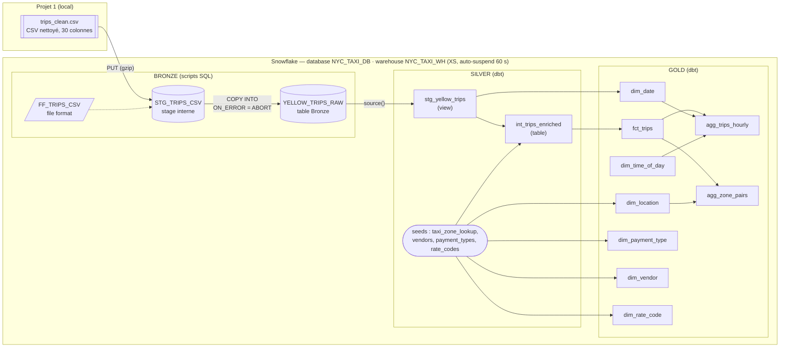
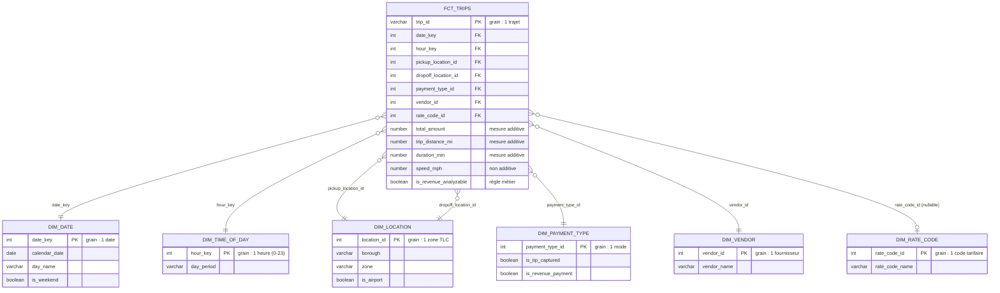

# Architecture

## 1. Flux de bout en bout

## 2. Schéma en étoile (couche GOLD)

Agrégats construits **depuis** `fct_trips` (mêmes définitions de mesures) :

| Table | Grain | Questions servies |
|---|---|---|
| `agg_trips_hourly` | une heure calendaire (date x heure) | Activité, revenus par période, périodes de pointe |
| `agg_zone_pairs` | un couple zone de départ x zone d'arrivée | Localisation : trajets et zones les plus fréquents |

## 3. Grain de chaque table

| Couche | Table | Une ligne = | Clé |
|---|---|---|---|
| Bronze | `YELLOW_TRIPS_RAW` | une ligne du CSV du Projet 1 (= un trajet) | `row_id` |
| Silver | `stg_yellow_trips` | un trajet | `trip_id` |
| Silver | `int_trips_enriched` | un trajet | `trip_id` |
| Gold | `fct_trips` | un trajet | `trip_id` |
| Gold | `dim_date` | une date calendaire | `date_key` |
| Gold | `dim_time_of_day` | une heure de la journée | `hour_key` |
| Gold | `dim_location` | une zone TLC | `location_id` |
| Gold | `dim_payment_type` | un mode de paiement | `payment_type_id` |
| Gold | `dim_vendor` | un fournisseur | `vendor_id` |
| Gold | `dim_rate_code` | un code tarifaire | `rate_code_id` |
| Gold | `agg_trips_hourly` | une date x une heure | (`date_key`, `hour_key`) |
| Gold | `agg_zone_pairs` | un couple de zones | (`pickup_location_id`, `dropoff_location_id`) |

Chaque clé est protégée par un test `unique` + `not_null` (ou
`unique_combination_of_columns` pour les clés composées).
