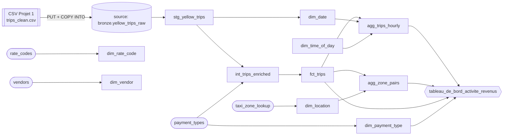

# Preuve — lineage dbt

_Généré depuis `target/manifest.json` le 2026-10-17 22:05:39 UTC. Même graphe que dans `dbt docs serve` (icône lineage en bas à droite) ; capture conseillée : `docs/evidence/lineage.png`._

